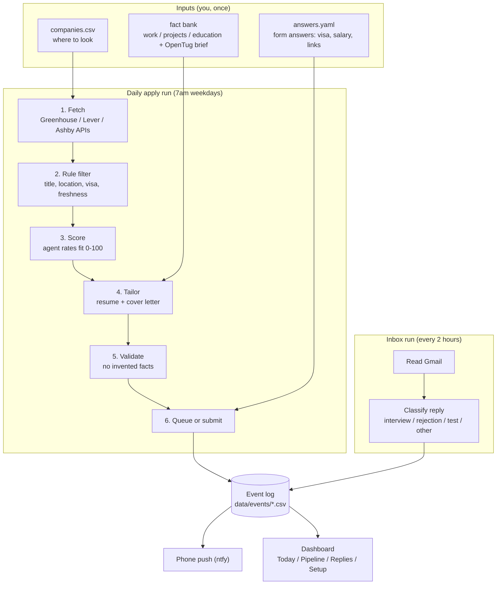
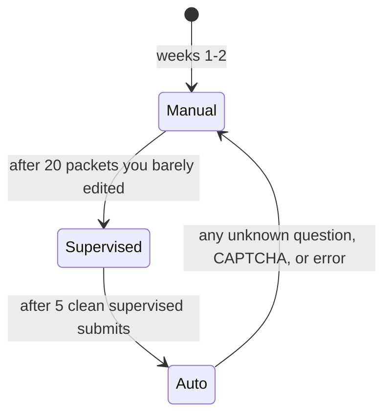
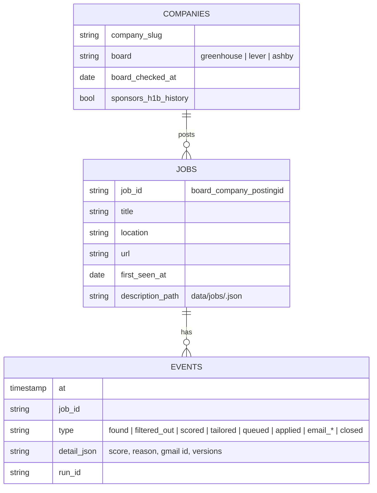

# Job Agent: the plan

**Goal:** every weekday, a robot finds Analytics Engineer and Data/BI Analyst jobs that fit you, writes a truthful resume and cover letter for each one, helps submit them, watches your inbox for replies, and logs everything so you can learn what works.

**What success looks like after 30 days:**

| Metric | Target |
|---|---|
| Packets ready each weekday | 30 |
| Tailored applications sent | 450+ over 30 days (fewer if supply is short; the dashboard shows why) |
| Your time per day | About 45 to 60 min in weeks 1 to 2 (manual), about 15 to 20 min once supervised submit works |
| Made-up facts on any resume | 0 |
| Replies tracked automatically | 100% |

---

## 1. The big picture

Think of a restaurant kitchen:

- **The pantry** is your *profile*: every true fact about you, prepped once.
- **The orders** are *job postings* coming in every morning.
- **The chef** is the *AI agent*: it reads each order and plates a custom dish (resume + cover letter) using only what's in the pantry.
- **The waiter** is the *submitter*: it carries the dish to the table (the application form).
- **The receipt book** is the *event log*: every action, written down, never erased.
- **The manager's report** is the *dashboard*: which dishes get sent back, which get compliments.



---

## 2. The one design rule that keeps this simple

> **Scripts are the hands. The agent is the brain.**

| Job | Who does it | Why |
|---|---|---|
| Calling job APIs, filtering, saving files, making PDFs, sending pushes | Python scripts | Same input gives the same output. Easy to test. Free. |
| Judging fit, rewording bullets, writing cover letters, reading emails | The Cursor agent | Needs judgment. The agent running the Automation *is* the AI, so no extra API key or bill. |

The agent never touches the network or files directly for the boring parts. It runs commands like `jobagent fetch` and reads the results. That means every brain decision is written down and every hand action is repeatable.

---

## 2b. Runtime: everything in Docker

```text
 the Mac mini (docker compose, see 3.11)                           outside
┌──────────────────────────────────────────────────────────┐
│ worker      supercronic cron ── jobagent CLI (hands)       │──► 8 public job-board APIs, career pages, HN (JSearch: week-1 gap check only)
│             └─ jobagent run ── Cursor SDK agent (brain) ───│──► Cursor API (CURSOR_API_KEY)
│                    │ MCP tools                             │──► ntfy.sh (phone push)
│                    ├─ jobagent MCP  (facts, render, check) │
│                    ├─ playwright MCP ──────────────────────│──► application forms (headless)
│                    └─ gmail MCP (read-only) ───────────────│──► Gmail API
│ playwright  mcr.microsoft.com/playwright/mcp  :8931        │
│ gmail       taylorwilsdon/google_workspace_mcp :8000       │  (profile: inbox, phase 5)
│ dashboard   Streamlit :8501 (localhost only)               │  (profile: dashboard, phase 3)
│ volume      ./ → /app  (profile/, data/events/, out/)      │
└──────────────────────────────────────────────────────────┘
```

| Command | What it does |
|---|---|
| `docker compose build` | Builds `jobagent:local`: Python 3.12, uv, Typst 0.15.1, poppler, Liberation fonts, supercronic |
| `docker compose up -d` | Starts the worker (cron) and the Playwright MCP |
| `docker compose --profile dashboard up -d` | Adds the dashboard at `localhost:8501` |
| `docker compose run --rm worker jobagent render profile/packets/base_lane_a.yaml --out out/lane_a` | Renders a resume and runs the ATS text check |

**Verified on 2026-10-22:** image builds; both lane packets render and pass the ATS round-trip check inside the container; the check fails on a mismatched packet; Playwright MCP answers `initialize` on `:8931`; the `jobagent` MCP lists its 3 tools and renders over stdio.

**Not yet verified (phase 4 spike):** whether a Cursor SDK *local* agent runs inside the Linux worker container. If it doesn't, the brain runs as a scheduled Cursor Automation on the private GitHub repo, and the container keeps the hands, the browser, and the dashboard.

### MCP servers

| Step | Server | Status | Why |
|---|---|---|---|
| Facts, render, ATS check | **`jobagent` MCP** (ours, `src/jobagent/mcp_server.py`) | Running | Gives the agent typed tools that only return confirmed facts. Grows to `validate_packet`, `log_event`, `queue` in phase 2 |
| Fill forms | **[Playwright MCP](https://github.com/microsoft/playwright-mcp)** (Microsoft, official) | Running | Headless Chromium in Docker, runs as a server on port 8931 |
| Read replies | **[google_workspace_mcp](https://github.com/taylorwilsdon/google_workspace_mcp)** (MIT, read-only mode) | Phase 5 | Works with free Gmail accounts, has a Docker setup |
| Query the event log | **[MotherDuck DuckDB MCP](https://github.com/motherduckdb/mcp-server-motherduck)** (official) | Phase 3 | Read-only connection doesn't lock the file, so scripts keep writing |
| Learn tab models | **[dbt-mcp](https://github.com/dbt-labs/dbt-mcp)** (dbt Labs, official) | Phase 7 | Runs dbt Core locally, no dbt Cloud needed |
| Company discovery | [ats-jobs-mcp](https://github.com/groundtruthtools/ats-jobs-mcp) | Phase 1 | Maps ~7,500 Greenhouse/Ashby boards; imported once into the registry (3.1.1) |
| Who hires my title | [DOL OFLC LCA disclosure data](https://www.dol.gov/agencies/eta/foreign-labor/performance) | Phase 1 | Main discovery input (3.1.1). Manual quarterly download; a script loads it |

Fetching jobs and sending pushes stay as scripts, not MCPs: they need no judgment.

**Avoided, and why** (full table in 3.10):
- **The LinkedIn MCP and AIHawk.** They log in as you. LinkedIn's User Agreement (8.2) bans bots, and LinkedIn banned the AIHawk contributors.
- **Aggregators as the main source.** JSearch and the LinkedIn Data API run only as a week-1 gap check (3.1.5). Our own discovery map is the main source.
- **JobSpy.** A switch in `config/sources.yaml`, set to off. It scrapes from the Mac mini's home IP.
- **Browserbase, Browser Use Cloud, and hosted resume renderers.** They send your visa and salary answers to a third party.
- **The Memory MCP.** A second copy of the facts breaks the truth-first rule.
- **ApplyPilot.** Worth reading for its dry-run idea; its fully automatic 1,000-jobs mode is the wrong approach.

---

## 3. The components

### 3.1 Find: companies first, then their jobs

**The idea in one line:** reading a company's jobs is easy and free. Knowing *which companies to read* is the hard part. Aggregators (JSearch, LinkedIn) mostly sell you that list. We build the list ourselves from public data, then read each company's own job board.

Think of it like fishing. The job boards are the ponds, and they're free to fish. The aggregator sells you a map of ponds. We draw our own map from government records of who has hired your role before.

```text
 1. WHO HIRES MY ROLE?          2. WHERE DO THEY POST?         3. WHAT'S OPEN TODAY?
 ┌──────────────────────┐      ┌───────────────────────┐      ┌──────────────────────┐
 │ H-1B filings (DOL)   │      │ resolver: guess board │      │ board APIs (9 kinds) │
 │ HN "Who is hiring"   │ ───► │ name → probe 8 boards │ ───► │ career-page job data │ ──► data/jobs/
 │ seed list, your list │      │ → check it's really   │      │ (daily / weekly /    │     → filter
 │ gap-check finds      │      │   them → registry     │      │  monthly by tier)    │     → score
 └──────────────────────┘      └───────────────────────┘      └──────────────────────┘
   weekly / quarterly             weekly + on demand              every weekday 7:00
```

#### 3.1.1 Step 1: who hires my role (discovery inputs)

| Input | What it gives | How we get it | Cadence |
|---|---|---|---|
| **DOL H-1B filings (LCA disclosure file)** | Every employer that filed to hire a "Data Analyst", "Analytics Engineer", "BI Engineer"... with title, worksite city/state, wage, and wage level | You download one `.xlsx` in a browser into `data/lca/`; a script loads it | Quarterly (4 × 2 min a year) |
| **HN "Who is hiring"** | Startups posting monthly, often with a careers URL | [Algolia HN API](https://hn.algolia.com/api), free, scriptable (verified 2026-10-22); the agent pulls company + URL out of each comment | Monthly |
| **Seed list** | ~7,500 known Greenhouse/Ashby boards ([ats-jobs-mcp](https://github.com/groundtruthtools/ats-jobs-mcp)) | One-time import, kept only for data-heavy industries | Once |
| **Your list** | Dream companies | A line in `companies.csv` | Any time |
| **Gap check** | Companies the measurement week (3.1.5) shows we missed | Automatic | Week 1, then monthly |

**Why the H-1B file is the best map.** It's official, free, and specific to your title:

```text
EMPLOYER_NAME        JOB_TITLE              WORKSITE   PW_WAGE_LEVEL  NEW_EMPLOYMENT
ACME FREIGHT INC     Analytics Engineer     Houston TX  II             1     ← hired a new person
ACME FREIGHT INC     Data Analyst           Houston TX  I              2     ← at entry level
BIGCONSULT LLC       Data Analyst           (14 sites)  II             0     ← renewals, body shop
```

What the loader keeps, using the official [record layout](https://www.dol.gov/agencies/eta/foreign-labor/performance):

- `CASE_STATUS` = Certified, `FULL_TIME_POSITION` = Y, decided in the last 2 fiscal years
- Title match on `JOB_TITLE` (lane A/B regex), backed by `SOC_CODE` (e.g. 15-2051 Data Scientists, 15-1211 Computer Systems Analysts, 13-1111 Management Analysts)
- Per employer: filings count, **new hires** (`NEW_EMPLOYMENT` + `CHANGE_EMPLOYER`, so renewals don't count), **entry-level share** (`PW_WAGE_LEVEL` I or II), states, and median wage for your titles
- A **consultancy flag** when one employer files for many worksites with almost no new hires (staffing firms). They go to the bottom, not the bin.

What the loader throws away on read: employer point-of-contact names, emails, phones, and attorney details. They're in the file; they never touch our disk. Hard rule: nobody in an H-1B file is ever contacted.

**Two signals, depending on your visa status** (open item 8 in section 11):

- If you need sponsorship: "sponsored this title in the last 2 years" becomes a strong score boost, and "no record + 'no sponsorship' in the posting" is a hard skip.
- If you don't: the file is still the best list of "companies that hire this exact title at entry level." Same data, used only for discovery.

**Verified 2026-10-22:** both dol.gov and uscis.gov return HTTP 403 to scripts (bot protection). We don't work around that. The download is manual, the Setup tab shows the file's age, and it turns red after 120 days.

#### 3.1.2 Step 2: where do they post (the resolver)

H-1B files have legal names ("ACME FREIGHT INC"), not job-board addresses. The resolver turns one into the other, cheapest method first:

```text
"ACME FREIGHT INC"
  1. name → slugs      acmefreight, acme-freight, acme            (free, instant)
  2. probe 8 boards    greenhouse ✗  lever ✗  ashby ✓ 23 jobs  ... (8 small GETs, 300 ms apart)
  3. is it really them?  board's company name ≈ "Acme Freight"  ✓
                         a US location on the board             ✓
                         a title like the H-1B titles           ✓   → confidence high → registry
  4. still unknown?    company website → careers page → look for a board link or job data
  5. still unknown?    agent queue: up to 50 a week, the agent finds the careers page and records proof
```

**Why step 3 matters (real example, 2026-10-22):** the slug `lovable` exists on two boards. Greenhouse's `lovable` is an Italian company ("Candidatura Spontanea", Ancona). Ashby's `lovable` is the AI company, with an **Analytics Engineer opening in Boston**, the same job LinkedIn showed us. A resolver without the check would have read the wrong company's jobs.

Boards the resolver probes (all public, no key; the same calls each company's own careers widget makes):

| Board | Endpoint | Verified | Apply |
|---|---|---|---|
| Greenhouse | `boards-api.greenhouse.io/v1/boards/{slug}/jobs` | ✓ live fetch | automatable |
| Lever | `api.lever.co/v0/postings/{slug}` | ✓ live fetch | automatable |
| Ashby | `api.ashbyhq.com/posting-api/job-board/{slug}` | ✓ live fetch | automatable |
| SmartRecruiters | `api.smartrecruiters.com/v1/companies/{id}/postings` | ✓ probe | manual until tested |
| Workable | `apply.workable.com/api/v1/widget/accounts/{slug}` | ✓ probe | manual until tested |
| Recruitee | `{slug}.recruitee.com/api/offers/` | ✓ probe | manual until tested |
| BambooHR | `{slug}.bamboohr.com/careers/list` | ✓ probe | manual until tested |
| Workday | `POST {tenant}.{wdN}.myworkdayjobs.com/wday/cxs/{tenant}/{site}/jobs` | not guessable: needs a real URL from step 4 | always manual |

A company that answers on no board is **not proof it isn't hiring**: Lever, Ashby, and SmartRecruiters return the same empty reply for "not here" and "here, zero openings." That's why step 3 needs a positive match, not just a 200.

**The registry** (`data/companies/registry.csv`, rebuilt weekly; `companies.csv` stays your hand-edited overrides):

| Field | Example |
|---|---|
| `company_key`, `name`, `legal_names` | `acme-freight`, Acme Freight, ACME FREIGHT INC |
| `board`, `slug`, `confidence`, `evidence` | ashby, acme-freight, high, "name match + Houston TX + 'Analytics Engineer'" |
| `sources` | lca, hn |
| `lca_new_hires`, `lca_entry_share`, `lca_median_wage`, `consultancy` | 3, 0.67, 98000, false |
| `tier`, `last_checked`, `status` | hot, 2026-10-22, resolved |

#### 3.1.3 Step 3: what's open today (fetch)

Every weekday `jobagent fetch` reads boards by **tier**, so a big registry stays fast and polite:

| Tier | Who | Read |
|---|---|---|
| Hot | A lane A/B job seen in the last 60 days, or H-1B entry-level new hires | Daily |
| Warm | Resolved, with your titles in H-1B history | Weekly |
| Cold | Everything else resolved | Monthly |

Politeness: one identifying User-Agent, at most 4 requests in flight, 300 ms between calls to the same host, back off on 429/5xx, never retry in a loop.

**Career-page reader** (for companies on no public board). Employers put structured job data (schema.org `JobPosting`, per [Google's guidelines](https://developers.google.com/search/docs/appearance/structured-data/job-posting)) on their job pages so Google for Jobs can list them. We read the same data straight from the employer:

```text
robots.txt allows it? → sitemap.xml → URLs that look like jobs → each page's <script type="application/ld+json">
  title · datePosted · validThrough (expired → drop) · hiringOrganization · jobLocation / TELECOMMUTE
  baseSalary · experienceRequirements.monthsOfExperience (feeds the ≤3 years rule) · directApply
```

**Verified 2026-10-22:** Airbnb's job pages carry this data. Lovable's careers page is drawn by JavaScript and has none in the raw page, but its Ashby board has everything. So the reader is a fallback, not the main path. Pages with no data in the raw HTML are marked `needs_browser` and skipped. Playwright stays reserved for filling forms.

#### 3.1.4 The apply-link picker

Every job, whatever the source, gets one best place to apply (`src/jobagent/apply_links.py`):

```text
apply options for one job:   LinkedIn → manual   Indeed → manual   jobs.ashbyhq.com → automatable ◄ picked
```

Order: Greenhouse/Lever/Ashby first, then the employer's own site, then LinkedIn/Indeed last.

#### 3.1.5 Measuring the gap (week 1), then dropping the paid sources

We don't trust our own coverage on faith. For one week, JSearch (free tier) runs the 6 standing queries alongside our system. For every JSearch job that passes the rule filter, `fetch` asks: did we already have it?

```text
JSearch found 40 good jobs this week
  ├─ 33 already in ours                                 → coverage 82%
  └─  7 missed: 4 company not in registry   → added automatically
                2 company unresolved        → agent queue
                1 LinkedIn-only (agency)    → ignored
```

Each check is a `coverage_check` event, so the dashboard shows the number. **Decision rule:** coverage ≥ 80% two weeks running → turn JSearch off and stop spending the key. Below 80% → add the missed companies, measure again. The LinkedIn Data API trial (2026-10-22) stays off; its jobs only apply on LinkedIn.

**Already verified on 2026-10-22:** `jobagent fetch --source ats` pulled 798 postings from 4 companies (dedupe works on a second run). Only 12 had analytics titles, nearly all Staff or Principal. That's the case for a discovery map built from *who hires this title at entry level*, not from famous names.

### 3.2 Rule filter (cheap, no AI)

Throws out obvious misses before the agent spends any effort.

| Rule | Keep if |
|---|---|
| Title | Matches Analytics Engineer, Data Analyst, BI Engineer, BI Analyst, Data Engineer. Excludes Senior, Staff, Lead, Manager, Director, Intern, and Machine Learning Engineer (exact list set in phase 0). |
| Location | Anywhere in the US: remote, hybrid, or onsite. Relocation is fine. |
| Years required | The posting asks for 3 years or fewer. Postings asking for 2 to 3 years are kept but tagged `stretch`. 4+ years is dropped. |
| Visa | Description does **not** contain "unable to sponsor", "no sponsorship", "must be authorized without sponsorship", or similar |
| Freshness | Posted in the last 14 days (early applicants get more replies) |
| Duplicate | Not already applied to this job, and fewer than 2 open applications at this company |

### 3.3 Score (the agent)

For each survivor the agent writes:

```json
{ "job_id": "ashby_notion_abc123", "score": 84, "lane": "A",
  "reasons": ["dbt + Snowflake core stack", "asks 1-3 yrs, you have 1.5", "remote US"],
  "gaps": ["Looker (you have Sigma)"] }
```

Only jobs scoring **70 or higher** get a resume. The day's target is **30**. The threshold is never lowered to hit it. If fewer than 30 pass, the run logs `supply_short` and the dashboard shows the gap, so the fix is more companies, not weaker matches.

**Lanes.** The same fact bank produces two resume orders. The agent picks one per job:

| Lane | Targets | Lead bullets |
|---|---|---|
| A: Analytics Engineer | dbt, Snowflake, BI engineering, logistics, marine, energy | OpenTug voyage table, event clocks, dbt CI |
| B: Data / BI Analyst | SQL plus dashboards, metric definitions, reconciliation | Chart reconciliation, utilization metric, Sigma |

Pure ML / Data Scientist roles are out of scope for now. Every packet records its lane, so the dashboard can show which lane gets replies.

### 3.4 Tailor (the agent) + Validate (script)

This is the part that must never lie.

**The fact bank is split by where a fact comes from.** Each bullet has an id, the true text, its skills, its numbers, and its evidence:

```text
profile/
├── work.yaml       shipped at a job      evidence: PR number or employer doc
├── projects.yaml   built in a project    evidence: repo + file path
└── education.yaml
```

```yaml
# work.yaml
experience:
  - company: OpenTug
    title: Data Scientist
    dates: 2025-10 to present
    bullets:
      - id: otug-ci
        text: Cut warehouse CI cost with a nightly full build, a cached manifest, and slim rebuilds of only what changed
        skills: [dbt, Snowflake, GitHub Actions, SQLFluff]
        numbers: []
        evidence: [ATDS#8993, ATDS#9095]

# projects.yaml
projects:
  - id: proj-lrcn
    name: Sign Language Video Classification
    skills: [PyTorch, OpenCV, MediaPipe]
    evidence: [Harshal12355/Sign-Language-Video-Classification-with-LRCN/train.py]
```

Work history is only OpenTug, C The Signs, and the Northeastern TA role. About 18 months of full-time work. The OpenTug brief is the only source for OpenTug bullets.

**The agent picks and rewords bullets, citing the source id:**

```json
{ "bullets": [
  { "source": "acme-1",
    "text": "Migrated 40 legacy reports to dbt on Snowflake, reducing nightly runtime from 3h to 25m" } ] }
```

**The validator rejects the packet if:**

- a bullet has no `source`, or cites one that doesn't exist
- a number appears that isn't in the source bullet
- a skill is listed that isn't in the fact bank
- a skill appears in a section its evidence doesn't support (PyTorch in a project is fine; PyTorch in an OpenTug bullet is rejected)
- a company, title, or date differs from the profile, or a company appears that isn't in `work.yaml`
- a claimed total experience exceeds what the dates add up to

Picture it like a bank teller checking a withdrawal slip against the account. Rewording is fine. Inventing money is not.

**Rendering:** one Typst template turns the tailored JSON into a single-column, ATS-friendly PDF in under a second. Cover letters: 3 short paragraphs, same fact check, plus one specific detail from the job description.

Every packet records `template_version` and `prompt_version`, so later you can compare which version gets more replies.

### 3.5 Submit



| Mode | What happens |
|---|---|
| **Manual** (start here) | The agent writes `queue/2026-10-23.md`: link, score, why, resume PDF, cover letter, ready-to-paste answers. You click apply, upload, submit, then tick the box. The next run logs it as applied. |
| **Supervised** | A browser script fills the form and screenshots it. You approve. It submits. |
| **Auto** | Same, without approval, only when: score ≥ 80, board is Greenhouse/Lever/Ashby, every question is in `answers.yaml`, and there is no CAPTCHA. |

**Hard rules for the submitter:**

- It only answers questions found in `answers.yaml`. Any unknown required question sends the job back to the manual queue. It never guesses.
- It never tries to get around a CAPTCHA.
- It screenshots the form before and after submitting, and saves both.
- Workday, LinkedIn, and Indeed are always manual. Their terms ban bots and they shut down accounts.

### 3.6 Inbox watcher (the agent + Gmail)

A second Cursor Automation runs every 2 hours with the Gmail connector:

1. Search mail from the last day that mentions a company in the tracker, or comes from job-system senders (Greenhouse, Lever, Ashby no-reply addresses).
2. Classify each email: `interview`, `assessment`, `rejection`, `offer`, `other`.
3. Match it to the application (company name + job title in the subject or body).
4. Write an event with the Gmail message id, so the same email is never counted twice.
5. Push to your phone.
6. On `interview` or `assessment`, write `out/<job_id>/interview_kit.md`: the saved job description, the exact bullets sent, the evidence behind each bullet, and the one story to tell.

### 3.7 Notify (ntfy)

One `curl` to a private, random topic name on ntfy.sh. Free. The app is on iOS and Android.

| Event | When you hear | Priority |
|---|---|---|
| Interview / assessment / offer | Immediately | High (buzzes) |
| Daily digest: "Applied 12, 3 waiting for you, 1 reply" | 7:30am | Normal |
| Rejections | Bundled into the evening digest, never one at a time | Low |

Rejections are bundled on purpose. Ten separate "no" buzzes a day wreck motivation. One calm summary doesn't.

### 3.8 How you use it: three surfaces

```text
          ┌─────────────────────┐
  phone   │  ntfy push          │  "30 ready · 2 replies · 1 interview"
          └─────────┬───────────┘
                    │ tap
                    ▼
          ┌─────────────────────┐
  laptop  │  Dashboard          │  where you DO things: submit, skip, read replies,
          │  jobagent dashboard │  see what setup is missing
          └─────────┬───────────┘
                    │ "change something"
                    ▼
          ┌─────────────────────┐
  Cursor  │  Chat with agent    │  "add this fact", "why did lane B lose?",
          │                     │  "stop applying to fintech"
          └─────────────────────┘
```

The phone only tells you. The dashboard is where you act. Chat is where you change the rules.

### 3.9 The dashboard

A local Streamlit app (`jobagent dashboard`, opens `localhost:8501`). It reads `data/events/*.csv` with DuckDB. Every button writes a new event to `data/events/<timestamp>_dashboard.csv`, so it follows the same receipt-book rule as everything else. A **Sync** button runs `git pull` to get the morning run's packets, then `git push` after you've worked the queue.

| Tab | What it shows | What you do there |
|---|---|---|
| **Today** | Goal bar (submitted / 30), the queue sorted by score: company, title, lane, score, stretch flag | Click **Open posting**, **Resume PDF**, **Cover letter**, **Copy answers**; then **Submitted** or **Skip (reason)** |
| **Pipeline** | Funnel for the last 14 days: found → passed filter → scored 70+ → queued → submitted → replied → interview. A `supply_short` line when fewer than 30 passed | Spot where the funnel narrows |
| **Replies** | Interviews, assessments, offers at the top with their interview kit; rejections folded below | Open the kit before the call |
| **Setup** | Everything that must be in place, red or green, each with a link to the file or page that fixes it | Clear the red items |
| **Learn** (phase 6) | Reply rate by lane, template version, days since posting, company size | Decide which lane gets more of the 30 |

**Setup tab checklist** (each item is a check the dashboard runs, not a note):

| Item | Turns green when | Link |
|---|---|---|
| C The Signs title and Tableau confirmed | no `needs_review` left in `work.yaml` | `profile/work.yaml` |
| Form answers filled | no `null` in `answers.yaml` except EEO | `profile/answers.yaml` |
| LinkedIn matches the resume | you tick it (titles and dates match, Indus Novateur removed) | linkedin.com/in/harshal-t |
| Private repo exists | `git remote -v` returns a URL | GitHub new repo page |
| Phone push works | a test push was acknowledged | ntfy app |
| Gmail connected | inbox run logged at least one event | Cursor integrations |
| 7am Automation running | an `apply` events file exists for today | Cursor Automations |
| Company list ≥ 500 | `companies.csv` row count | `companies.csv` |

### 3.10 Runtime: Docker plus MCP servers

Everything runs from `docker compose`. Picture a small office: one desk worker (scripts on a timer), one screen on the wall (dashboard), one browser in a locked room (Playwright), one mail clerk (Gmail MCP). The agent is the manager who walks between them.

```text
 docker compose
 ┌──────────────────────────────────────────────────────────────────────┐
 │  worker  (jobagent:local)                                            │
 │    supercronic → jobagent run daily | inbox | discover               │
 │    typst · pdftotext · uv · python 3.12          stdio MCP:          │
 │    data/events/*.csv  data/jobs/  out/            jobagent-mcp ◄─┐   │
 │                                                                  │   │
 │  dashboard  (same image)   localhost:8501   Streamlit            │   │
 │                                                                  │   │
 │  playwright (mcr.microsoft.com/playwright/mcp) localhost:8931 ◄──┤   │
 │    headless Chromium, fills forms, screenshots                   │   │
 │                                                                  │   │
 │  gmail  (taylorwilsdon/google_workspace_mcp) localhost:8000 ◄────┤   │
 │    read-only Gmail, OAuth                                        │   │
 └──────────────────────────────────────────────────────────────────┼───┘
                                                                    │
                         the brain: Cursor agent ───────────────────┘
                         (IDE chat now; Cursor SDK from the worker in phase 4)
```

**Verified on 2026-10-22:** the image builds, both lane PDFs render inside it and pass the text round-trip check, the Playwright MCP answers on `:8931`, and `jobagent-mcp` lists its tools over stdio.

**MCP servers**

| Step | Server | Status | Why |
|---|---|---|---|
| Fact bank, render, ATS check | `jobagent-mcp` (ours, `src/jobagent/mcp_server.py`) | **Running** | Typed tools so the agent can only read confirmed facts and render through the checker. Grows with `validate_packet`, `log_event`, `queue` in phase 2. |
| Fill forms | [Playwright MCP](https://github.com/microsoft/playwright-mcp) (Microsoft) | **Running** | Official, 28k stars, headless Docker image. Bound to localhost: it is not a security boundary. |
| Read replies | [google_workspace_mcp](https://github.com/taylorwilsdon/google_workspace_mcp) | Phase 5 (`--profile inbox`) | MIT, maintained, works with personal Gmail, read-only mode. Google's official Gmail MCP is a fallback once personal-account support is confirmed. |
| Query the event log | [MotherDuck DuckDB MCP](https://github.com/motherduckdb/mcp-server-motherduck) | Phase 3 | Official, read-only by default, so scripts keep writing while the agent reads. |
| Learn tab models | [dbt-mcp](https://github.com/dbt-labs/dbt-mcp) | Phase 7 | Official, works with local dbt Core. |
| H-1B filings | DOL LCA disclosure file loaded by a script | Phase 1 | Official data. Feeds discovery (3.1.1) and, if you need sponsorship, scoring. |
| Company research | [OpenWeb Ninja MCP](https://github.com/openweb-ninja/openwebninja-mcp) (official, `--profile research`) | **Running** | Same key as JSearch. 51 tools; the `company-research` skill allows 3: Glassdoor interviews, salary ranges, news. Job search stays on `jobagent-mcp` so credits are counted. Pinned to 0.3.0: young package. |

**Discovery is scripts first, with our own MCP tools on top.** The cron runs `jobagent discover` (weekly) and `jobagent fetch` (weekdays). In chat, `jobagent-mcp` gives the agent tools that cost nothing:

| Tool | What it answers | Status |
|---|---|---|
| `find_companies(title, state, entry_level, sponsors)` | "Who hires Analytics Engineers in Texas at entry level?" (from H-1B data plus the registry) | Phase 1 |
| `company_profile(name)` | Board, open lane A/B jobs, H-1B history, consultancy flag | Phase 1 |
| `resolve_company(name, domain?)` | Runs the resolver now and shows its evidence | Phase 1 |
| `search_local_jobs(query, filters)` | Searches every job already in `data/jobs/` | Phase 1 |
| `resolve_apply_link`, `list_found_jobs` | As today | Running |
| `search_jsearch` (renamed from `search_jobs`) | Paid fallback, counted against the budget | Running, gap check only |

**Rejected or limited on purpose**

| Tool | What it does | Decision |
|---|---|---|
| LinkedIn MCP | Logs into LinkedIn *as you* and reads or acts through your session | **No.** Breaks User Agreement 8.2; the risk is your real account getting restricted mid-search |
| AIHawk | Logs in and auto-clicks Easy Apply on LinkedIn | **No.** LinkedIn banned its contributors. Easy Apply also gets the fewest replies |
| JobSpy | Scrapes LinkedIn/Indeed search pages logged out | **Opt-in, off.** No account risk, but it breaks their terms and the blocks land on your friend's home IP |
| Browserbase, Browser Use Cloud | Rent you a Chrome running in *their* data center | **No.** Every form field (visa status, salary floor, phone) passes through their servers. Our Playwright runs on the mini |
| RenderCV cloud, JSON Resume MCP | Turn your resume data into a PDF on *their* server | **No.** Typst does the same locally in under a second |
| Memory MCP for facts | A second copy of the fact bank that the validator can't see. |

**Brain runtime (phase 4 spike).** Three ways to run the agent on a schedule. Try them in this order:

- **A. Cursor SDK inside the worker.** `jobagent run daily` runs the scripts, then calls `Agent.prompt(...)` with the `daily-apply-run` skill and the MCP servers above. Everything stays on the mini. Open question: does the SDK's local runtime work inside a Linux container?
- **C. Cursor CLI on the mini itself (macOS, outside Docker).** A `launchd` job at 7:00 runs the agent with this repo as its workspace. It reaches the containers on `localhost`, the same way your laptop's Cursor does today. Known to run on macOS; costs one extra install.
- **B. Cursor Automation (cloud) on a cron.** Proven scheduling, but the data lives on the mini and the cloud can't reach the mini's Playwright. Last resort.

**Volume.** The goal is as many *truthful, tailored, fresh* applications as supply allows. Start at 30 a day. Raise `daily_goal` once a week of `supply_short` events says there's more to apply to.

### 3.11 Hosting: your friend's Mac mini

The mini is the always-on office. Your laptop is where you *build*. Your phone is where you *approve*.

```text
  your laptop                     Mac mini (friend's home, always on)           outside
 ┌──────────────┐  git push   ┌──────────────────────────────────────┐
 │ Cursor IDE   │ ──► GitHub ─┼► git pull (scripts/deploy.sh)        │
 │ edit code,   │  (private)  │                                      │
 │ fact bank    │             │  docker compose                      │──► job boards, JSearch
 └──────┬───────┘             │   worker · playwright · gmail ·      │──► Cursor API (brain)
        │  Tailscale (private │   dashboard                          │──► ntfy (pushes)
        │  network, no open   │                                      │──► healthchecks.io ping
        │  ports)             │  data/ out/  ── nightly backup.sh ───┼──► GitHub: job-agent-data
 ┌──────┴───────┐             │                                      │      (second private repo)
 │ phone        │ ── https ──►│  tailscale serve → dashboard :8501   │
 │ ntfy + dash  │             └──────────────────────────────────────┘
 └──────────────┘
```

**Two kinds of files, two directions.** This is the rule that keeps it from getting tangled:

| Kind | Examples | Edited on | Flows |
|---|---|---|---|
| Code + profile | `src/`, `profile/`, skills, `companies.csv` | Your laptop | laptop → GitHub → mini (`deploy.sh`) |
| Run data | `data/events/`, `data/jobs/`, `out/` | The mini only | mini → `job-agent-data` repo nightly (`backup.sh`) |

The mini never commits to the code repo, so `git pull` never conflicts. Events are one new file per run, so the backup only ever adds files.

**One-time setup (about 1.5 hours, with your friend there for steps 1 and 2):**

1. Friend creates a **standard** (non-admin) macOS user `jobagent` and turns on FileVault.
2. Friend runs `scripts/mini-setup.sh` from their admin account: no sleep, auto-restart after power loss.
3. As `jobagent`: install Docker Desktop (start at login, 4 CPUs / 6 GB cap), Tailscale, git. Clone the repo, copy `.env`.
4. `tailscale serve --bg 8501`: the dashboard appears at `https://<mini>.<tailnet>.ts.net` on your phone and laptop, nowhere else.
5. Phase 5: run the Gmail OAuth sign-in once *on the mini* (it opens a browser there). The token stays on the mini.
6. From your laptop: `ssh jobagent@<mini> '~/job-agent/scripts/deploy.sh'`. Done when `docker compose ps` shows everything `Up`.

**Your daily loop doesn't change.** 7:00 the mini runs; your phone buzzes; you open the dashboard over Tailscale; you approve; the mini submits. Cron times stay Eastern even if the mini isn't (`TZ` in the containers).

**What can go wrong, and what catches it:**

| Failure | What happens | Catch |
|---|---|---|
| Power cut / macOS update reboot | Mini restarts, but **FileVault waits for a password** before anything runs | healthchecks.io: no ping for 3 h → push to your phone → text your friend to log in |
| Docker Desktop updates itself | Containers stop until it restarts | `restart: unless-stopped` + same dead-man's switch |
| Friend's internet drops | Runs fail, nothing is lost | Next run picks up; `source_error` events show the gap |
| Mini dies | Lose at most one day | `job-agent-data` repo has everything up to last night |

**Honest trust note.** FileVault protects the disk if the mini is stolen. It does **not** protect you from the mini's admin: your friend could read `.env`, `answers.yaml` (visa, salary), and the Gmail token. Keep the blast radius small: Gmail is read-only and revocable at [Google account permissions](https://myaccount.google.com/permissions), the backup token can only touch one repo, and the Cursor key can be rotated from the dashboard. Only do this with a friend you'd hand a printed copy of your application answers to.

**Their internet, their IP.** Every request leaves from your friend's home connection. That's fine for public job-board APIs, JSearch, and normal form submits (one person applying looks like one person applying). It's the main reason JobSpy stays off: LinkedIn rate-limit blocks would hit your friend's own browsing.

**Hardware.** Apple Silicon or Intel both work: the Dockerfile picks the right Typst build, and the Playwright image is multi-arch (verified on arm64). Load is light: Chromium uses ~1 GB while filling a form, PDFs add ~1 MB a day.

---

## 4. The data model: a receipt book, not a whiteboard

A whiteboard gets erased and rewritten ("status: applied" becomes "status: rejected"), and the history is gone. A **receipt book** only ever adds lines. Your current status is just the latest receipt.

It works like your bank balance: the bank doesn't store "balance = $500". It stores every deposit and withdrawal, and the balance is calculated from them.



**Two tricks that prevent headaches:**

1. **One events file per run:** `data/events/2026-10-23T0700_apply.csv`. The apply run and the inbox run never edit the same file, so git merge conflicts can't happen. DuckDB reads them all at once with `data/events/*.csv`.
2. **Save every job description** in `data/jobs/`. Postings disappear when the job closes, and you will want that text when you prep for the interview.

---

## 5. A day in the life

```mermaid
gantt
    title Weekday schedule (your local time)
    dateFormat HH:mm
    axisFormat %H:%M
    section Robot
    Apply run (fetch, filter, score, tailor 30) :07:00, 90m
    Morning digest push                         :08:30, 5m
    Inbox checks every 2h                       :09:00, 10h
    Evening digest (incl. rejections)           :19:00, 5m
    section You
    Dashboard Today tab, submit queue           :09:00, 60m
```



The 60 minutes is weeks 1 to 2, when you click every submit yourself (about 2 minutes each). Once supervised submit works on Greenhouse, Lever, and Ashby, it drops to about 15 to 20 minutes: you approve screenshots instead of filling forms.

Weekly (Sunday): discovery run adds new companies and re-checks boards.

---

## 6. Repo layout

```text
job-agent/
├── PLAN.md                    # this file
├── AGENTS.md                  # the agent's job description: daily steps + hard rules
├── docker-compose.yml         # worker, dashboard, playwright, gmail
├── docker/                    # Dockerfile, crontab
├── config/manual_ats.yaml     # sites never automated
├── config/sources.yaml        # JSearch queries + budget, JobSpy switch (off)
├── scripts/                   # deploy.sh, backup.sh, mini-setup.sh (Mac mini)
├── .env.example               # secrets template (.env is gitignored)
├── .cursor/
│   ├── mcp.json               # jobagent-mcp (docker stdio) + playwright (:8931)
│   ├── rules/                 # truth-first, hands-and-brain, python-code, privacy
│   └── skills/                # resume-principles, tailor-application, daily-apply-run,
│                              # submit-application, referral-note, inbox-triage, add-fact
├── profile/
│   ├── opentug_brief.md       # the only source for OpenTug work
│   ├── work.yaml              # fact bank: jobs (evidence = PR numbers)
│   ├── projects.yaml          # fact bank: projects (evidence = repo files)
│   ├── education.yaml
│   ├── answers.yaml           # form answers (private, you fill these)
│   ├── preferences.yaml       # lanes, titles, years, goal, threshold
│   ├── packets/               # base_lane_a.yaml, base_lane_b.yaml
│   └── resume.typ             # PDF template (reads a packet)
├── companies.csv              # slug, board, checked_at
├── src/jobagent/
│   ├── sources/ats.py         # 8 public board adapters (Greenhouse ... BambooHR, Workday)
│   ├── sources/careers_page.py # robots.txt → sitemap → JobPosting JSON-LD
│   ├── sources/jsearch.py     # JSearch adapter (week-1 gap check only)
│   ├── discovery/lca.py       # H-1B file → per-employer title/wage/new-hire summary (drops contact columns)
│   ├── discovery/hn.py        # HN "Who is hiring" threads via Algolia
│   ├── discovery/resolver.py  # name → slugs → probe → verify → registry
│   ├── discovery/registry.py  # data/companies/registry.csv, tiers
│   ├── apply_links.py         # which board an apply link is on, automatable or not
│   ├── fetch.py               # `jobagent fetch`: dedupe, save, log "found", JSearch budget
│   ├── filter.py              # rule filter
│   ├── validate.py            # the "no lies" checker
│   ├── render.py              # Typst -> PDF
│   ├── events.py              # append events
│   ├── notify.py              # ntfy push
│   ├── submit/                # phase 5: one browser script per board
│   ├── mcp_server.py          # jobagent-mcp: list_facts, render_packet, check_rendered_pdf
│   ├── dashboard.py           # Streamlit app: Today / Pipeline / Replies / Setup / Learn
│   └── cli.py                 # `jobagent fetch | filter | render | validate | log | notify | dashboard`
├── data/
│   ├── lca/                   # H-1B .xlsx you download quarterly (public data, gitignored: large)
│   ├── companies/registry.csv # who hires your titles, where they post, tier
│   ├── jobs/                  # saved job descriptions
│   └── events/                # receipt book, one file per run
├── out/<job_id>/              # resume.pdf, cover.pdf, tailored.json, screenshots
├── queue/YYYY-MM-DD.md        # today's "click submit" list
├── dbt/                       # phase 6
└── tests/
```

**Tools:** Python 3.12 + `uv`, `httpx`, Typst (PDFs), Playwright (phase 5), DuckDB + `dbt-duckdb` (phase 6). The repo **must be private**: it holds your phone number, visa status, and salary answers.

---

## 7. The analytics layer (phase 7, the Learn tab): your portfolio piece

dbt models on the receipt book:

```text
stg_events  ->  fct_applications (one row per job, latest status, days to reply)
            ->  fct_funnel       (found -> filtered -> applied -> replied -> interview)
            ->  dim_companies    (board, sponsorship history, reply rate)
```

Questions it answers:

1. What % of applications get any human reply? An interview?
2. Do jobs applied to within 48 hours of posting reply more?
3. Which resume template/prompt version wins?
4. Which job titles and company sizes reply most?
5. Which companies ghost (no reply after 21 days)?

**H-1B join:** the registry already carries each company's H-1B summary (3.1.1). In the Learn tab, join it to replies: do companies with entry-level new hires for your title reply more often?

---

## 8. Build phases

Each phase works on its own. Stop after any phase and you still have something useful.

| # | Phase | Build time | Done when |
|---|---|---|---|
| 0 | **Foundations:** fact bank with evidence, lane A/B base packets, resume template, rules, 7 skills, Docker image, Playwright MCP, `jobagent` MCP, ATS PDF check | **Done 2026-10-22** + your 30 min review | You've read the fact bank, every fact is true, and nothing from Indus Novateur is in it |
| 1 | **Find + filter (section 3.1):** ~~3 board adapters, JSearch adapter, apply-link picker, `jobagent fetch`~~ (done 2026-10-22). Left, in order: **1a** 5 more board adapters + registry (1 hr) · **1b** H-1B loader (1 hr, after your first download) · **1c** resolver with the "is it really them" check (1 hr) · **1d** tiers + career-page reader (1 hr) · **1e** HN + 4 MCP tools + skill update (45 min) · **1f** rule filter (45 min) | ~5.5 hr left | Registry has 500+ resolved companies, `jobagent fetch && jobagent filter` shows real daily supply, and you agree with the top 20 |
| 1g | **Gap check week:** JSearch runs alongside; `coverage_check` events | 1 week, no build | Coverage ≥ 80% two weeks running → JSearch off |
| 1h | **Move to the Mac mini:** section 3.11 setup, deploy, backup, Tailscale | 1.5 hr (with friend) | Dashboard opens on your phone over Tailscale, and last night's backup is on GitHub |
| 2 | **Tailor + queue + validator:** scoring, tailoring, validator with tests, PDFs, events | 3 hr | 10 packets in a row with zero invented facts |
| 3 | **Dashboard (Today + Setup + Pipeline):** Streamlit over the event log | 2 hr | You work one full day's queue from the dashboard only |
| 4 | **Daily automation + phone push:** Cursor Automation at 7am weekdays, digests | 1 hr | Phone gets the digest 3 weekdays in a row |
| 5 | **Inbox watcher + interview kits:** Gmail connected, classifier, events, high-priority pushes | 2 hr | A real reply updates the dashboard within 2 hours |
| 6 | **Supervised submit:** spike first, then Playwright adapters, dry-run, screenshots | 1 hr spike + 3 hr | 10 dry runs match what you'd submit, then 5 clean supervised submits |
| 7 | **Learn tab:** dbt-duckdb models, H-1B join | 3 hr | You can answer "which lane gets more replies" with a number |

You are applying to real jobs from the end of **phase 2** (about 5.5 hours of build). The dashboard lands right after, so you never work the queue from a markdown file for more than a day or two.

---

## 9. Things to check before trusting the plan (spikes)

| Risk | Check | If it fails |
|---|---|---|
| Cursor cloud agents may not run a headless browser | Phase 5 spike: run one Playwright script inside a Cursor Automation | Run the submitter on your Mac while it's awake, or in GitHub Actions |
| Can Cursor Automations check out a repo hosted on Cursor Origin, or only GitHub/GitLab? | Phase 3: try it | Host the private repo on GitHub |
| Greenhouse postings have an `ai_disclaimer` field | Phase 1: read what a few say | If a company asks applicants not to use AI, send it to the manual queue with a flag |
| CAPTCHA / bot checks on forms | Phase 5 dry runs | Manual queue, always |
| Same job posted on two boards gives a duplicate | Phase 1: also dedupe on company + normalized title | n/a |
| `job-agent-data` repo grows ~1 MB per day of PDFs | Watch after month 1 | Prune rejected packets older than 90 days |
| Cursor chat on the laptop needs the MCP servers that now run on the mini | Phase 1b: try Cursor Remote-SSH into the mini | `ssh -L 8931:127.0.0.1:8931 mini` tunnel, and `ssh mini docker compose run ...` for `jobagent-mcp` |
| Streamlit's live connection through `tailscale serve` | Phase 3: open the dashboard on the phone | Set `server.enableXsrfProtection` / `baseUrlPath` |
| Our own discovery misses too much | Phase 1g gap check: coverage ≥ 80% | Keep JSearch as a small daily top-up (free tier) |
| Resolver picks the wrong company (the `lovable` case) | Phase 1c: hand-check 30 random "high confidence" matches | Raise the bar: require 2 of 3 checks, send the rest to the agent queue |
| H-1B file is too big to load quickly | Phase 1b: time the load in DuckDB | Load once a quarter into `data/lca/lca.parquet`; never re-read the `.xlsx` |
| Most H-1B employers are consultancies, not real employers | Phase 1b: count flagged vs not | Tighten the flag (worksites per filing, new-hire share) |
| Career pages mostly need JavaScript | Phase 1d: share of `needs_browser` | Leave them; they're usually on a board the resolver finds anyway |

---

## 10. Hard rules (never cut)

1. No invented facts. The validator blocks the packet, no exceptions.
2. Visa and work-authorization answers are always truthful and come only from `answers.yaml`.
3. No unknown question gets guessed. It goes to the manual queue.
4. No CAPTCHA bypass. No LinkedIn, Indeed, or Workday bots (`config/manual_ats.yaml`).
5. Every submit needs an `approved` event from the dashboard. Volume comes from finding more good matches, never from skipping approval.
6. At most 2 open applications per company.
7. Private repo. Random ntfy topic name.
8. A 403 or bot check means stop, on any site. We never fake a browser to get past one (dol.gov and uscis.gov are manual downloads for this reason). Career pages: robots.txt is obeyed.
9. Nobody named in a public filing (H-1B contacts, attorneys) is ever stored or contacted.

---

## 11. What I need from you before phase 0

Already answered: OpenTug brief, OpenTug title (Data Scientist), about 18 months of experience, lanes A + B, up to 3 years required, anywhere in the US, 30 per day, C The Signs 95M+ records, projects (MBTA and MTG MCP on the resume).

Still open (these show as red on the Setup tab):

1. C The Signs title ("Data Scientist" or "Data Scientist Intern") and whether you used Tableau there
2. F1 at C The Signs: only if you remember the real number. It's left off until then.
3. `answers.yaml`: current city, salary floor, visa wording, start date, EEO
4. 5 to 10 dream companies
5. GitHub or Cursor Origin for the private repo (two repos: `job-agent` code, `job-agent-data` backups)
6. ~~JSearch API key~~ (in `.env` as `OPENWEBNINJA_API_KEY`, 2026-10-22)
7. Your friend's OK on the trust note in 3.11, and an hour with them for setup steps 1 and 2
8. **Do you need visa sponsorship, now or later (for example after OPT)?** It decides whether H-1B history is a score boost or only a discovery map (3.1.1). Goes into `answers.yaml`.
9. **First H-1B download** (2 min): [dol.gov performance data](https://www.dol.gov/agencies/eta/foreign-labor/performance) → LCA Programs → the FY2026 Q3 disclosure `.xlsx` (DOL spells the file name "Dislclosure") and FY2025 Q4 → save both into `data/lca/`
